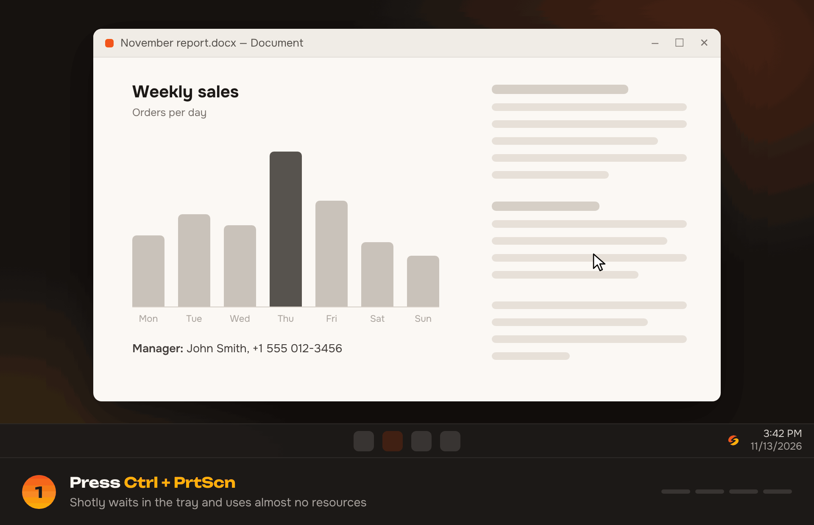
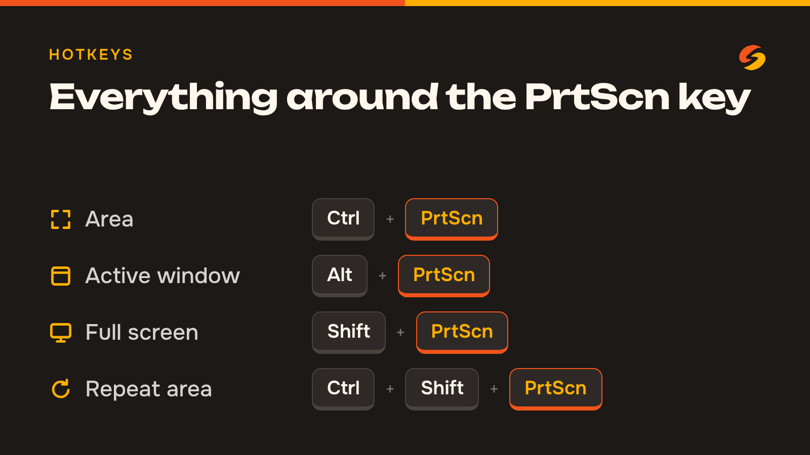
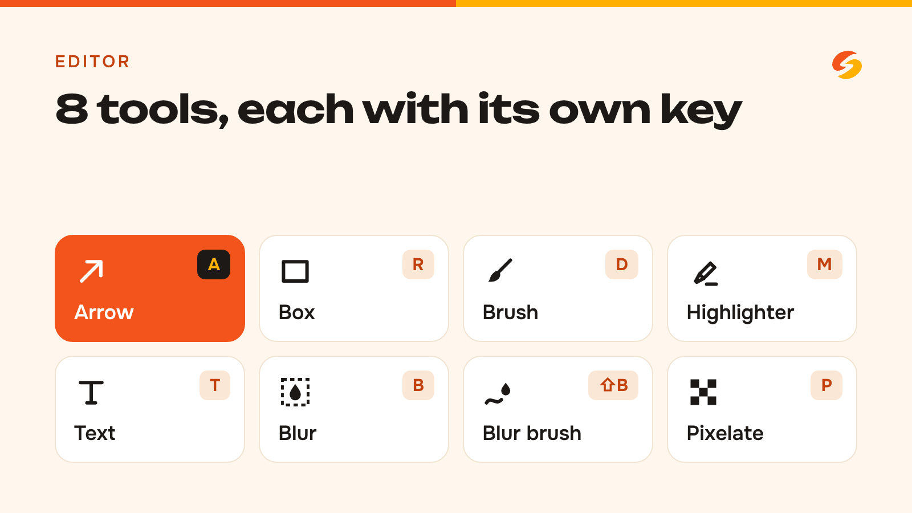
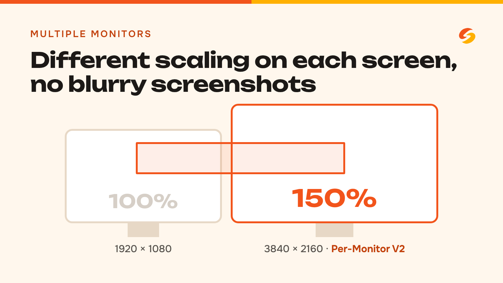
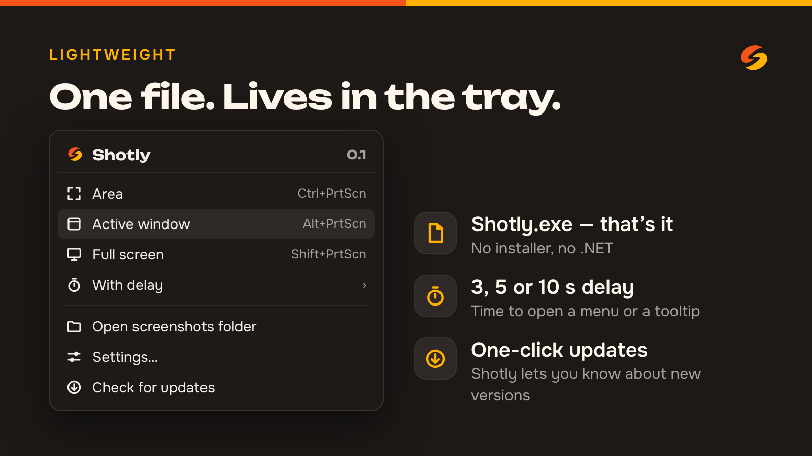

<div align="center">

<sub><a href="README.md">Русский</a> · <b>English</b></sub>

<picture>
  <source media="(prefers-color-scheme: dark)" srcset="assets/brand/shotly-logo-horizontal-on-dark.svg">
  
</picture>

### Fast screenshots for Windows

Select, annotate, copy — in seconds. A lightweight Snipping Tool alternative<br>
with global hotkeys and proper multi-monitor support.

<br>

<a href="https://github.com/loudscreamx/Shotly/releases/latest/download/Shotly.exe">
  
</a>

<sub>A single <code>Shotly.exe</code>, no installer and no .NET required · <a href="https://github.com/loudscreamx/Shotly/releases/latest">What's new in the latest version</a> · <a href="https://github.com/loudscreamx/Shotly/releases">All versions</a></sub>

<br><br>


</div>

<br>

<p align="center">
  
</p>

---

## Getting started

1. Click **Download for Windows** above to get `Shotly.exe`.
2. Run it. Shotly appears in the tray (next to the clock) and waits for a hotkey.
3. Press **Ctrl+PrtScn** and select an area — the screenshot is already in the clipboard, no need to click Copy.

> If Windows shows “Windows protected your PC”, click “More info” → “Run anyway”:
> the program isn't signed with a certificate yet.

Settings, autostart and update checks are in the tray icon menu.

## Features

<p align="center">
  
  
  
  
</p>

| | |
| --- | --- |
| ✂️ **Area capture** | Dimmed screen, a frame with its size in pixels, crosshair. Click without dragging to capture the whole monitor. The selection goes straight to the clipboard |
| 🪟 **Window and screen** | The active window or the whole monitor under the cursor with one shortcut, with a flash frame around what was captured |
| 🔁 **Repeat area** | Capture the same area again — handy for a series of shots |
| ✏️ **Editor on top of the selection** | Arrow, box, brush, highlighter, text, area and brush blur, pixelate, 6 colors plus a custom one, undo and redo |
| 🖥️ **Multiple monitors** | Different DPI on each monitor, a separate overlay for each (Per-Monitor V2) |
| ⏱️ **Delay** | 3, 5 or 10 seconds to open a menu or a tooltip first |
| 💾 **Saving** | PNG or JPG, your own folder, copy to clipboard with one key |
| 🪶 **Lightweight** | Lives in the tray and uses almost no resources in the background |
| 🌍 **13 languages** | English, Russian, Ukrainian, German, French, Spanish, Italian, Portuguese, Polish, Turkish, Chinese, Japanese, Korean. Follows the Windows language; can be changed in settings |

## Hotkeys

| Action | Keys |
| --- | --- |
| Area | <kbd>Ctrl</kbd> + <kbd>PrtScn</kbd> |
| Active window | <kbd>Alt</kbd> + <kbd>PrtScn</kbd> |
| Full screen | <kbd>Shift</kbd> + <kbd>PrtScn</kbd> |
| Repeat last area | <kbd>Ctrl</kbd> + <kbd>Shift</kbd> + <kbd>PrtScn</kbd> |

Shortcuts can be changed in settings (tray menu → “Settings…”).

<details>
<summary><b>Keys while selecting and in the editor</b></summary>

<br>

**Selection**

| Action | Keys |
| --- | --- |
| Copy and close | <kbd>Enter</kbd> or <kbd>Ctrl</kbd> + <kbd>C</kbd>, double-click the selection |
| Save to file | <kbd>Ctrl</kbd> + <kbd>S</kbd> |
| Close | <kbd>Esc</kbd> |
| Move by 1 px (by 10 px) | arrow keys (<kbd>Ctrl</kbd> + arrows) |
| Resize | <kbd>Shift</kbd> + arrows |
| Reset the selection | right-click |

**Editor** — <kbd>E</kbd> or the “Edit” button after selecting

| Tool | Key |
| --- | --- |
| Arrow | <kbd>A</kbd> |
| Box | <kbd>R</kbd> |
| Brush (opaque) | <kbd>D</kbd> |
| Highlighter (semi-transparent) | <kbd>M</kbd> |
| Text (click to start, <kbd>Enter</kbd> to finish, <kbd>Shift</kbd> + <kbd>Enter</kbd> for a new line) | <kbd>T</kbd> |
| Blur area | <kbd>B</kbd> |
| Blur brush | <kbd>Shift</kbd> + <kbd>B</kbd> |
| Pixelate | <kbd>P</kbd> |
| Line thickness and text size | slider on the toolbar, mouse wheel, <kbd>[</kbd> / <kbd>]</kbd> |
| Straight highlighter and brush lines, even arrow angles, square boxes | draw while holding <kbd>Shift</kbd> |
| Move text / resize it | drag the frame / the corner handles (with the Text tool — also finished text) |
| Custom color | the rainbow dot after the colors on the toolbar |
| Undo / redo | <kbd>Ctrl</kbd> + <kbd>Z</kbd> / <kbd>Ctrl</kbd> + <kbd>Y</kbd> |

<kbd>Esc</kbd> closes the screenshot without saving. If there are edits already, press <kbd>Esc</kbd> twice (a hint appears after the first press), so a stray keypress doesn't throw your work away. While the mouse button is held, <kbd>Esc</kbd> cancels only the shape being drawn.
Annotations are saved at the screen's native resolution. The chosen thickness is remembered for each tool.

</details>

<details>
<summary><b>Using PrtScn on its own</b></summary>

<br>

By default, <kbd>PrtScn</kbd> on its own and <kbd>Win</kbd> + <kbd>PrtScn</kbd> stay with Windows: in Windows 11, <kbd>PrtScn</kbd> opens Snipping Tool.
If you assign <kbd>PrtScn</kbd> alone in Shotly's settings, Shotly turns off “Use the Print screen key to open screen capture”
in Windows and shows a notification. You can turn it back on in “Settings → Accessibility → Keyboard”.

The old defaults (Ctrl+Shift+S/W/F/R) are replaced with the new ones on update; custom shortcuts are left untouched.

</details>

## Planned

- Highlight the window under the cursor while selecting
- Overlay in the brand colors

## For developers

Stack: C# / .NET 10 / WPF, screen capture, hotkeys and DPI via the Win32 API.
Single-file build: `dotnet publish src/Shotly/Shotly.csproj -c Release -o publish`, see [docs/BUILD.md](docs/BUILD.md) (in Russian).
Every merge into `main` is built in CI and published as a new release — the Download button always points to the latest version.

Translations live in `src/Shotly/Localization/Languages/*.json`. To fix a translation or add a language, see [docs/TRANSLATING.md](docs/TRANSLATING.md).

<details>
<summary><b>Project structure</b></summary>

```
src/Shotly/
  App.xaml(.cs)          entry point, single instance, capture scenarios
  Native/                Win32 P/Invoke (user32, gdi32, shcore, dwmapi)
  Core/                  monitors and DPI, screen capture, settings, hotkeys, output, autostart, updates, log
  Capture/               CaptureSession — the state of one selection
  Overlay/               overlay window per monitor, selection drawing, mini toolbar
  Editor/                annotations, editor state, composing the final image
  Tray/                  tray icon and menu
  UI/                    settings window, hotkey field, delay countdown
  Localization/          UI translations (Languages/*.json) and language selection
docs/
  PITFALLS.md            DPI, monitors, protected content, admin rights
  BUILD.md               single-file .exe build and autostart
  TRANSLATING.md         how to fix a translation or add a language
assets/brand/            logo, colors and fonts (README inside)
```

</details>

Want to help? See [CONTRIBUTING.md](CONTRIBUTING.md) (in Russian) or [support the project via CloudTips](https://pay.cloudtips.ru/p/a59652bd). Found a vulnerability? See [SECURITY.md](SECURITY.md).
Logo, colors and fonts: [assets/brand](assets/brand/README.md). License: [MIT](LICENSE).
