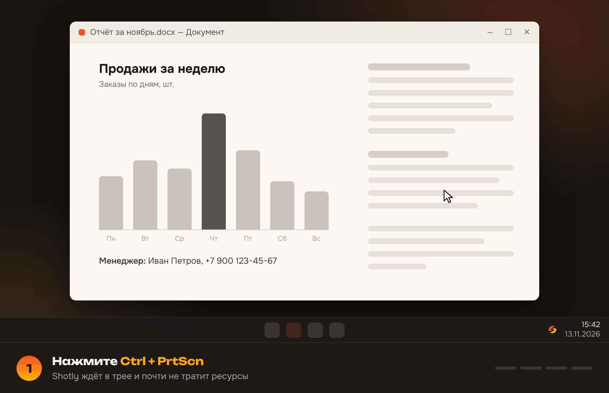
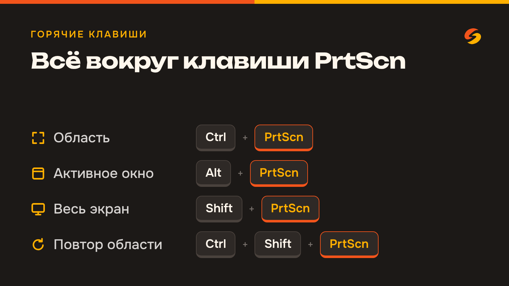
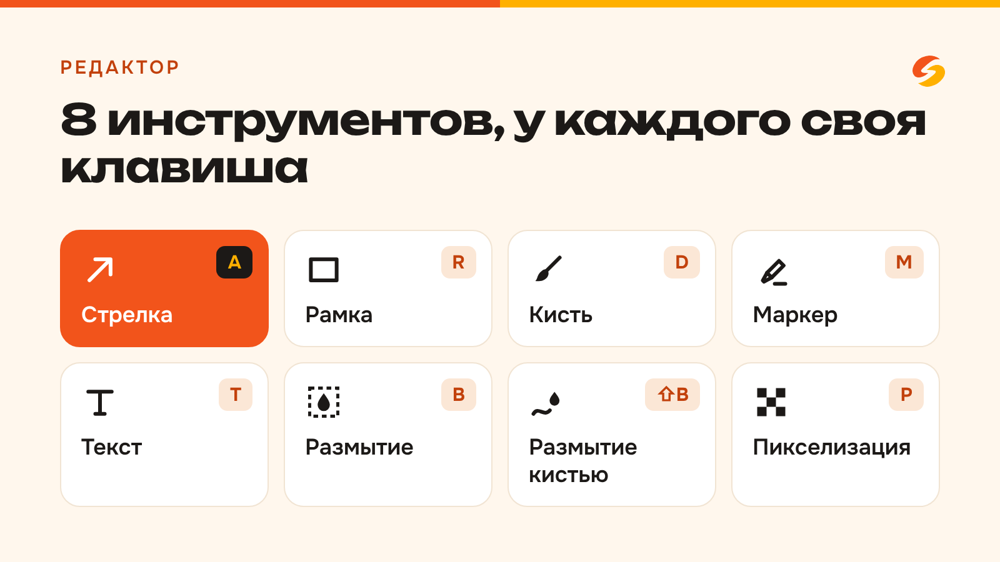
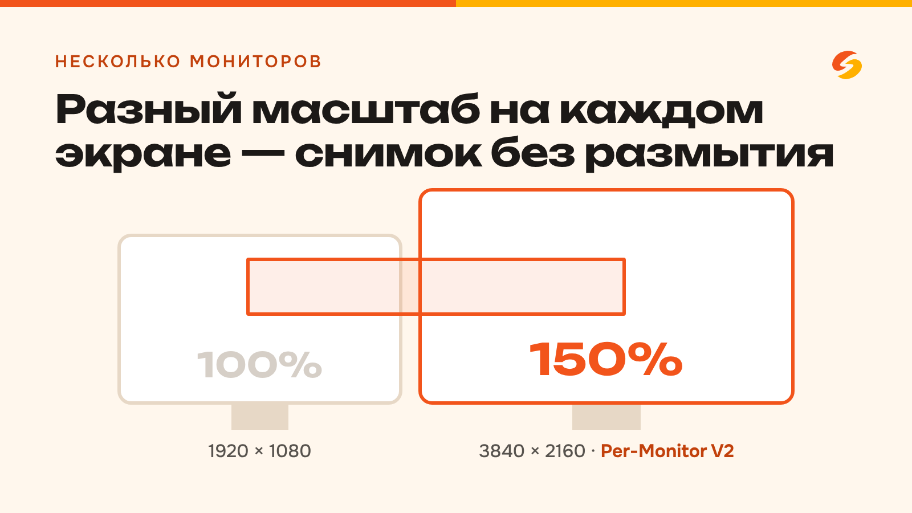
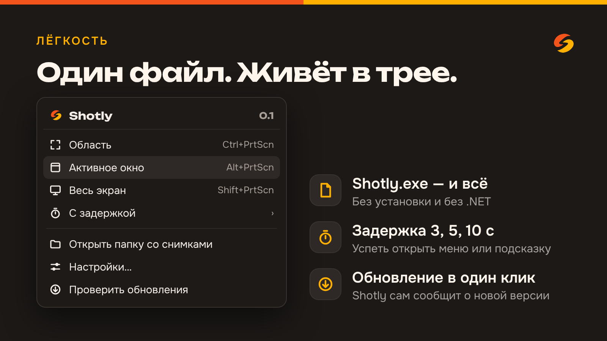

<div align="center">

<sub><b>Русский</b> · <a href="README.en.md">English</a></sub>

<picture>
  <source media="(prefers-color-scheme: dark)" srcset="assets/brand/shotly-logo-horizontal-on-dark.svg">
  
</picture>

### Быстрые скриншоты для Windows

Выделил, дополнил, скопировал — за секунды. Лёгкая замена «Ножницам»<br>
с глобальными горячими клавишами и честной работой на нескольких мониторах.

<br>

<a href="https://github.com/loudscreamx/Shotly/releases/latest/download/Shotly.exe">
  
</a>

<sub>Один файл <code>Shotly.exe</code>, установка и .NET не нужны · <a href="https://github.com/loudscreamx/Shotly/releases/latest">Что нового в последней версии</a> · <a href="https://github.com/loudscreamx/Shotly/releases">Все версии</a></sub>

<br><br>


</div>

<br>

<p align="center">
  
</p>

---

## Как начать

1. Нажмите кнопку **«Скачать для Windows»** выше — загрузится `Shotly.exe`.
2. Запустите файл. Shotly появится в трее (возле часов) и будет ждать горячих клавиш.
3. Нажмите **Ctrl+PrtScn** и выделите область — снимок сразу в буфере обмена, кнопку «Копировать» нажимать не нужно.

> Если Windows покажет «Система Windows защитила ваш компьютер», нажмите «Подробнее» → «Выполнить в любом случае»:
> программа пока не подписана сертификатом.

Настройки, автозапуск и проверка обновлений — в меню значка в трее.

## Возможности

<p align="center">
  
  
  
  
</p>

| | |
| --- | --- |
| ✂️ **Захват области** | Затемнение экрана, рамка с размером в пикселях, прицел — всё в фирменных цветах. Клик без перетаскивания — весь монитор. Выделенное сразу попадает в буфер обмена |
| 🪟 **Окно и экран** | Активное окно или весь монитор под курсором одним сочетанием, со вспышкой-рамкой вокруг снятого |
| 🔁 **Повтор области** | Снять ту же область ещё раз — удобно для серии кадров |
| ✏️ **Редактор поверх выделения** | Стрелка, рамка, кисть, маркер, текст, размытие областью и кистью, пикселизация, 6 цветов и свой цвет, отмена и повтор |
| 🖥️ **Несколько мониторов** | Разный DPI на каждом мониторе, отдельный оверлей на каждый (Per-Monitor V2) |
| ⏱️ **Задержка** | 3, 5 или 10 секунд, чтобы успеть открыть меню или подсказку |
| 💾 **Сохранение** | PNG или JPG, своя папка, копирование в буфер одним нажатием |
| 🪶 **Лёгкость** | Живёт в трее и почти не тратит ресурсы в фоне |
| 🌍 **13 языков** | Русский, английский, украинский, немецкий, французский, испанский, итальянский, португальский, польский, турецкий, китайский, японский, корейский. Язык берётся из Windows, сменить можно в настройках |

## Горячие клавиши

| Действие | Клавиши |
| --- | --- |
| Область | <kbd>Ctrl</kbd> + <kbd>PrtScn</kbd> |
| Активное окно | <kbd>Alt</kbd> + <kbd>PrtScn</kbd> |
| Весь экран | <kbd>Shift</kbd> + <kbd>PrtScn</kbd> |
| Повторить последнюю область | <kbd>Ctrl</kbd> + <kbd>Shift</kbd> + <kbd>PrtScn</kbd> |

Сочетания меняются в окне настроек (меню трея → «Настройки…»).

<details>
<summary><b>Клавиши в режиме выделения и в редакторе</b></summary>

<br>

**Выделение**

| Действие | Клавиши |
| --- | --- |
| Копировать и закрыть | <kbd>Enter</kbd> или <kbd>Ctrl</kbd> + <kbd>C</kbd>, двойной клик по выделению |
| Сохранить в файл | <kbd>Ctrl</kbd> + <kbd>S</kbd> |
| Закрыть | <kbd>Esc</kbd> |
| Сдвинуть на 1 px (на 10 px) | стрелки (<kbd>Ctrl</kbd> + стрелки) |
| Изменить размер | <kbd>Shift</kbd> + стрелки |
| Сбросить выделение | правый клик |

**Редактор** — <kbd>E</kbd> или кнопка «Правка» после выделения

| Инструмент | Клавиша |
| --- | --- |
| Стрелка | <kbd>A</kbd> |
| Рамка | <kbd>R</kbd> |
| Кисть (непрозрачная) | <kbd>D</kbd> |
| Маркер (полупрозрачный) | <kbd>M</kbd> |
| Текст (клик — начать, <kbd>Enter</kbd> — готово, <kbd>Shift</kbd> + <kbd>Enter</kbd> — новая строка) | <kbd>T</kbd> |
| Размытие области | <kbd>B</kbd> |
| Размытие кистью | <kbd>Shift</kbd> + <kbd>B</kbd> |
| Пикселизация | <kbd>P</kbd> |
| Толщина линий и размер текста | ползунок на панели, колесо мыши, <kbd>[</kbd> / <kbd>]</kbd> |
| Прямая линия маркером и кистью, ровный угол стрелки, квадратная рамка | рисовать с зажатым <kbd>Shift</kbd> |
| Подвинуть текст / изменить размер | перетащить за рамку / за угловые ручки (инструментом «Текст» — и готовый текст) |
| Свой цвет | радужный кружок после цветов на панели |
| Отменить / повторить | <kbd>Ctrl</kbd> + <kbd>Z</kbd> / <kbd>Ctrl</kbd> + <kbd>Y</kbd> |

<kbd>Esc</kbd> закрывает снимок без сохранения. Если правки уже есть, нужно нажать <kbd>Esc</kbd> дважды (после первого нажатия появится подсказка), чтобы случайное нажатие не выбросило работу. С зажатой мышью <kbd>Esc</kbd> отменяет только фигуру, которая рисуется.
Аннотации сохраняются в исходном разрешении экрана. Выбранная толщина запоминается для каждого инструмента.

</details>

<details>
<summary><b>Как назначить одиночную PrtScn</b></summary>

<br>

По умолчанию одиночная <kbd>PrtScn</kbd> и <kbd>Win</kbd> + <kbd>PrtScn</kbd> остаются за Windows: в Windows 11 <kbd>PrtScn</kbd> открывает «Ножницы».
Если назначить одиночную <kbd>PrtScn</kbd> в настройках Shotly, он сам выключит в Windows «Использовать клавишу Print Screen
для захвата экрана» и покажет уведомление. Вернуть параметр можно в «Параметры → Специальные возможности → Клавиатура».

Старые умолчания (Ctrl+Shift+S/W/F/R) при обновлении автоматически меняются на новые; свои сочетания не трогаются.

</details>

## В планах

- Подсветка окна под курсором в режиме выделения

## Для разработчиков

Стек: C# / .NET 10 / WPF, захват экрана, горячие клавиши и DPI через Win32 API.
Сборка в один файл: `dotnet publish src/Shotly/Shotly.csproj -c Release -o publish`, подробнее в [docs/BUILD.md](docs/BUILD.md).
Каждый мерж в `main` собирается в CI и публикуется как новый релиз — кнопка «Скачать» всегда ведёт на свежую версию.

<details>
<summary><b>Структура проекта</b></summary>

```
src/Shotly/
  App.xaml(.cs)          точка входа, один экземпляр, сценарии захвата
  Native/                P/Invoke Win32 (user32, gdi32, shcore, dwmapi)
  Core/                  мониторы и DPI, снимок экрана, настройки, хоткеи, вывод, автозапуск, обновления, лог
  Capture/               CaptureSession — состояние одного выделения
  Overlay/               окно-оверлей на монитор, отрисовка выделения, мини-панель
  Editor/                аннотации, состояние редактора, сборка итоговой картинки
  Tray/                  иконка и меню трея
  UI/                    окно настроек, поле горячей клавиши, счётчик задержки
  Localization/          переводы интерфейса (Languages/*.json) и выбор языка
docs/
  PITFALLS.md            DPI, мониторы, защищённый контент, права администратора
  BUILD.md               сборка в один .exe и автозапуск
  TRANSLATING.md         как поправить перевод или добавить язык
assets/brand/            логотип, цвета и шрифты (README внутри)
```

</details>

Хотите помочь — [CONTRIBUTING.md](CONTRIBUTING.md) или [поддержать проект через CloudTips](https://pay.cloudtips.ru/p/a59652bd). Нашли уязвимость — [SECURITY.md](SECURITY.md).
Логотип, цвета и шрифты: [assets/brand](assets/brand/README.md). Лицензия: [MIT](LICENSE).
